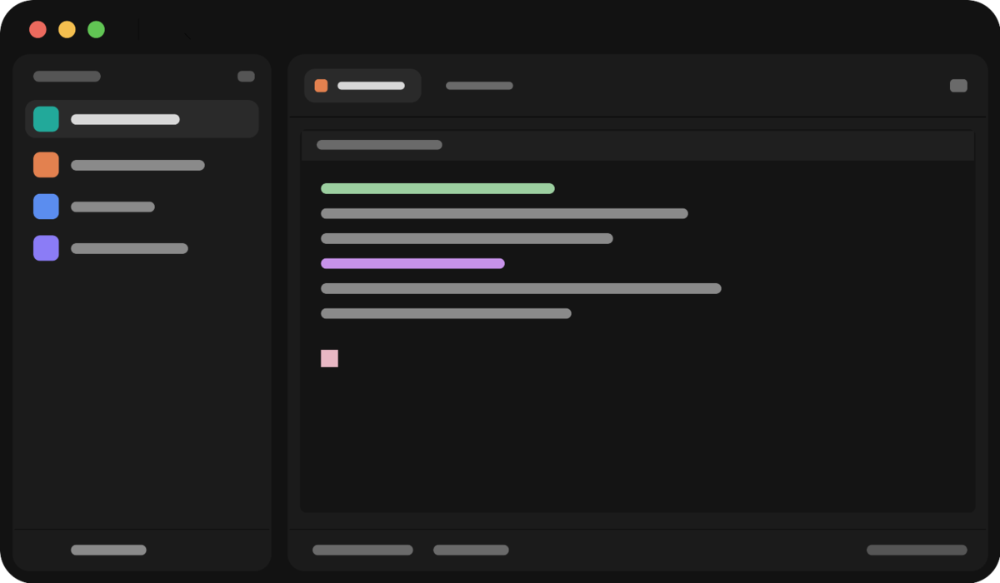

# Cam: a layout and mod for Herdr

Cam is a [Herdr](https://herdr.dev) layout with its own mod. It replaces Herdr's window chrome with a quieter, card-based design.



## What's in it

- **Sidebar.** Each workspace gets a small creature instead of a letter tile. Its eyes dart while an agent works. Under each workspace, one row per tab shows a Claude icon for agents and `>_` for shells. A working agent's icon turns orange, a blocked one shows `!`, and a finished one shows a dot. A split tab is one row with an icon for each pane.
- **Tab bar, pane headers and status bar.**
- **Picker, command palette and settings.** These open with `cmd-p`, `cmd-shift-p` and `cmd-,`.
- **Dialogs** for renaming, closing panes and quitting.
- **Toasts** in the same style.
- **A right-click menu** for terminals (the `cam-menu` mod).
- **Harbor** (`cmd-shift-e`). A demo panel that shows agents working through client requests. All of its data is made up: see [`mods/cam/modules/harbor/data.js`](mods/cam/modules/harbor/data.js).

## Install

Herdr reads mods and layouts from `~/.config/herdr-app`. There's no install command: you copy the folders in.

1. Get the files:

   ```sh
   git clone https://github.com/camerontredoux/herdr-cam.git
   cd herdr-cam
   ```

2. Copy the mods and the layout. If you already have a mod or layout with one of these names, rename yours first, because these commands overwrite it.

   ```sh
   cp -R mods/cam mods/cam-menu ~/.config/herdr-app/mods/
   cp layouts/cam.json layouts/cam.svg ~/.config/herdr-app/layouts/
   ```

3. Add the key bindings. Merge each section of `keys.cam.json` (`global`, `mod:cam` and `layout:cam`) into your `~/.config/herdr-app/keys.json`. Check for keys you already use first. The `global` section rebinds `cmd-q`, `cmd-w`, `cmd-p`, `cmd-e` and others.

4. Check that the mod loads:

   ```sh
   herdr-app check ~/.config/herdr-app/mods/cam
   ```

5. Switch to the layout. Use `ctrl-shift-l` to cycle layouts, or run:

   ```sh
   herdr-app do layout.switch '{"name":"cam"}'
   ```

## Before you install: what it changes

Herdr mods are trusted code. They can run commands and touch files. Cam does these things:

- **Replaces the toast mod.** On every start, Cam writes its own `~/.config/herdr-app/mods/toast/main.js`. It also deletes any `toast-edited*` folders that Herdr leaves after you edit a toast. If you've changed `mods/toast` yourself, those changes are lost.
- **Runs `git`** in your workspaces' folders. The sidebar uses it to show branch and ahead/behind counts.
- **Runs Herdr's own `hc machine` commands** to list, add and reconnect remote machines from the sidebar and settings.

It doesn't use the network.

## Updating

Pull the repo and copy the folders again (step 2). Herdr reloads the mod as soon as the files change.

## Licence

[MIT](LICENSE)
